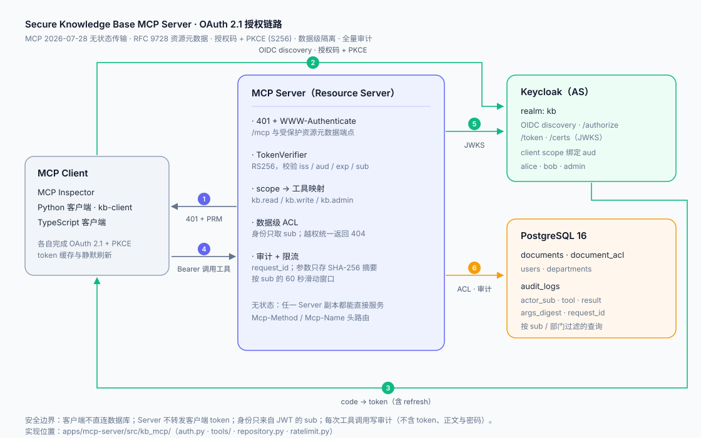

# Secure Knowledge Base MCP Server

> 一个用 **OAuth 2.1 + PKCE** 保护的企业知识库 MCP Server：身份可信、权限最小、数据隔离、行为可审计。

[](https://github.com/DragonYi1722/mcp-oauth-kb/actions)


> 状态：第 1–10 周完成。Keycloak realm、PKCE、JWT 验签、scope/ACL、审计、限流、双客户端与安全负向测试均已实跑；
> GitHub Actions 四个 job（单测 / 双客户端 / 镜像 / Keycloak 端到端）全绿。演示脚本见 [docs/05](docs/05-演示脚本.md)。

---

## 这个项目解决什么问题

企业知识库接入 AI 客户端后，常见做法是发一个静态 API Key，所有人权限相同，工具参数里还带着 `user_id`，出了问题也查不到是谁调的。

本项目把 MCP Server 实现为标准的 **OAuth Resource Server**：

- 客户端通过**授权码 + PKCE (S256)** 登录，token 由 Keycloak 签发；
- Server 本地用 JWKS 验签，校验 `iss` / `aud` / `exp` / `sub`；
- scope 映射到工具（`kb.read` / `kb.write` / `kb.admin`）；
- 身份**只**取 token 的 `sub`，入参里的身份字段一律忽略；
- 文档按 个人 / 部门 / 全公司 三级隔离，越权统一返回 `NOT_FOUND`；
- 每次工具调用写审计，参数只存 SHA-256 摘要；
- 按用户滑动窗口限流，超限返回 `RATE_LIMITED`。

## 架构



1. 未带 token 的请求收到 `401` 与 `WWW-Authenticate: Bearer resource_metadata="..."`；
2. 客户端按 RFC 9728 拉取受保护资源元数据，从 RFC 8414 / OIDC discovery 拿到授权服务器；
3. 浏览器完成授权码 + PKCE，回调换取 token；
4. 客户端带 `Authorization: Bearer` 与 `Mcp-Method` / `Mcp-Name` 头调用工具；
5. Server 拉取 JWKS 验签，scope 决定能调哪些工具；
6. 身份来自 `sub`，ACL 决定能看到哪些文档，审计落库。

完整时序与模块划分见 [docs/02-工程方案.md](docs/02-工程方案.md)。

## 技术栈

| 层 | 选型 |
|---|---|
| 协议 | MCP 2026-07-28（Streamable HTTP，无状态） |
| Server | Python 3.13 + 官方 `mcp==2.3.0` |
| 授权服务器 | Keycloak 26.7.x |
| 数据库 | PostgreSQL 16 |
| 客户端 | MCP Inspector / Python SDK / TypeScript SDK |
| 部署 | Docker Compose + Caddy |

## 30 分钟跑起来

### 0. 前置要求

Docker Desktop、Python 3.12+、Node.js 20+（仅 TS 客户端与 Inspector）。

```bash
git clone https://github.com/DragonYi1722/mcp-oauth-kb.git
cd mcp-oauth-kb
python -m venv .venv
source .venv/Scripts/activate          # Windows Git Bash；Linux/macOS 用 .venv/bin/activate
pip install -e "apps/mcp-server[dev]" -e apps/py-client
cp .env.example .env
```

不想装 Keycloak 也可以先跑：默认 `KB_STORAGE_BACKEND=memory`，自带 alice / bob / admin 与 9 篇演示文档，直接 `python -m kb_mcp.server` 即可，只是没有 OAuth 环节。

### 1. 启动 Keycloak 与 PostgreSQL

```bash
docker compose -f infra/docker-compose.yml up -d --wait postgres keycloak
python scripts/check_keycloak.py --wait 120
```

realm `kb` 与 3 个用户由 `realm-kb.json` 自动导入，控制台 `http://localhost:8080`（`admin` / `admin`）。
国内网络下 Docker Hub 可能超时，Compose 已改用 AWS ECR Public 镜像；`quay.io` 拉不动时可用
`powershell -ExecutionPolicy Bypass -File scripts\start_keycloak_native.ps1` 原生启动。

写入带有真实 `sub` 的种子数据（realm 重新导入后 `sub` 会变，加 `--reset`）：

```bash
python scripts/bootstrap_seed.py --reset
```

### 2. 启动服务端

```bash
KB_AUTH_ENABLED=true KB_STORAGE_BACKEND=postgres python -m kb_mcp.server
```

监听 `http://localhost:8000`。健康检查 `curl http://localhost:8000/healthz`，就绪检查 `/readyz`（含 PostgreSQL 与 JWKS）。

### 3. 用客户端登录

Python（client `mcp-cli`）：

```bash
kb-client login          # 浏览器登录 alice / password
kb-client whoami
kb-client search 复盘
```

TypeScript：

```bash
cd apps/ts-client && npm ci && npm run build
node dist/index.js login
node dist/index.js whoami
```

两个客户端各自实现 discovery → S256 → loopback 回调 → 换 token → 缓存 → 静默刷新，不依赖 Inspector 或脚本的 token。

无浏览器验收（脚本替浏览器提交登录表单，驱动两端各跑一遍真实授权流程）：

```bash
python scripts/verify_clients.py    # 期望 6 行 PASS
```

## 验证清单

| 检查 | 命令 / 操作 | 期望 |
|---|---|---|
| 健康检查 | `curl localhost:8000/healthz` | `{"status":"ok"}` |
| 就绪检查 | `curl localhost:8000/readyz` | `storage` 与 `jwks` 均 `ok`；故障 503 |
| 资源元数据 | `curl localhost:8000/.well-known/oauth-protected-resource/mcp` | RFC 9728 JSON |
| 未登录 | 不带 token 调工具 | 401 + `WWW-Authenticate` |
| 认证冒烟 | `python scripts/smoke_auth.py` | 6 项 `PASS` |
| 三用户隔离 | `python scripts/demo_week5.py` | alice 6 / bob 5 / admin 4 篇可见，越权均 `NOT_FOUND` |
| 双客户端 OAuth | `python scripts/verify_clients.py` | 6 项 `PASS`（含 refresh） |
| 端到端演示 | `python scripts/demo_portfolio.py` | 按顺序打印 401 → 登录 → 检索 → 越权 → 审计提示 |
| 安全单测 | `cd apps/mcp-server && pytest -m "security and not integration"` | 20 项通过 |
| 安全负向（live） | `cd apps/mcp-server && pytest -m "security and integration"` | 11 项通过 |
| 全量测试 | `cd apps/mcp-server && pytest -m "not integration"` | 68 项通过，覆盖率 ≥ 70% |
| 限流 | 同一用户 60 秒内第 61 次调用 | `RATE_LIMITED` + `denied` 审计 |
| 镜像 | `docker build -t kb-mcp apps/mcp-server` | 构建成功，容器 `/healthz` 200 |
| HTTPS 代理 | `curl -k https://localhost/readyz` | `{"status":"ready"}`（见下文） |
| CI | GitHub Actions | `python` / `clients` / `docker` / `integration` 四个 job |

## 3 分钟演示

[docs/05-演示脚本.md](docs/05-演示脚本.md) 给了逐镜头分镜、旁白与故障预案；录屏前先跑：

```bash
python scripts/demo_portfolio.py
```

它按演示顺序真实执行：未登录 401 + PRM → alice 登录 → `whoami` → 检索 → 新建文档 → 跨部门读取被隐藏 → 只读 token 归档被拒，并在结尾提示查看审计日志。

## Docker 与 HTTPS

```bash
cp .env.example .env
docker compose -f infra/docker-compose.yml up -d postgres keycloak
python scripts/bootstrap_seed.py --reset

# 方式一：本机跑 Server，Caddy 代理到宿主
KB_AUTH_ENABLED=true KB_STORAGE_BACKEND=postgres python -m kb_mcp.server
DOMAIN=localhost MCP_UPSTREAM=host.docker.internal:8000 \
  docker compose -f infra/docker-compose.yml --profile public up -d --no-deps caddy

# 方式二：Server 也放进 Compose
docker compose -f infra/docker-compose.yml up -d --build mcp-server
DOMAIN=localhost docker compose -f infra/docker-compose.yml --profile public up -d caddy

curl -k https://localhost/readyz
```

Caddy 本地用内部 CA，浏览器首次访问需信任证书。公网部署（真实域名、Let's Encrypt、`KC_HOSTNAME`、realm audience 调整）见
[docs/02-工程方案.md](docs/02-工程方案.md) 第 10 节。

## 项目结构

```
mcp-oauth-kb/
├── apps/
│   ├── mcp-server/      # MCP Server（auth / tools / repository / ratelimit / audit）
│   ├── py-client/       # Python OAuth 客户端（kb-client）
│   └── ts-client/       # TypeScript 客户端（官方 SDK + 手写 PKCE）
├── infra/               # Compose / Keycloak realm / Caddy / PostgreSQL init
├── docs/                # 计划书、工程方案、安全设计、工具契约、演示脚本、博客
├── scripts/             # 校验、取 token、种子、冒烟、演示
└── .github/workflows/   # 四个 job 的 CI
```

## 安全设计

完整威胁模型（STRIDE + 10 类威胁 + 测试矩阵）见 [docs/03-安全设计.md](docs/03-安全设计.md)。

| 威胁 | 对策 | 测试 |
|---|---|---|
| Confused deputy | 身份只取 `sub`，工具层 ACL | live S-09 |
| Token passthrough | 不透传客户端 token | JWKS 请求不带 `Authorization` |
| Audience confusion | `aud` 必须等于本服务 URL | 错误 `aud` 返回 401 |
| PKCE 降级 | 只接受 S256，缺 `code_verifier` 失败 | live S-11 |
| 重放 | 短 TTL + refresh + 撤销流程 | 过期 token 401 |
| 越权 / IDOR | 查询强制按 `sub` / 部门过滤，返回 404 | live S-08 / S-09 |
| 注入 | 参数化 SQL、长度与分页上限 | live S-10 |
| 日志泄密 | 参数只存摘要，日志扫描无 token/正文 | 单测 + 日志扫描 |
| 回调滥用 | 回调白名单，拒绝非法 `redirect_uri` | live S-12 |
| 滥用 | 按 `sub` 的滑动窗口限流 | live S-14 |

## 已知限制

- Keycloak 26 的 `--import-realm` 不创建内置 client scope，`basic`（提供 `sub`）必须在 realm JSON 中显式定义；
- `fullScopeAllowed=false` 会丢弃未显式授权的 realm 角色，本项目设为 `true`（工具权限仍由 scope 控制）；
- Keycloak 26.7 对 RFC 8707 `resource` 参数仅实验性支持，audience 通过 per-scope mapper 绑定；
- Inspector 会自动申请 `offline_access`，client 的 optional scopes 与用户 realm 角色都要包含它；
- 限流计数在进程内，多副本部署时每副本各有一套预算；严格全局配额需要 Redis；
- 反向代理应限制请求体大小，本项目在应用层只限制单字段长度；
- 开发用户密码仅用于本地演示，生产必须替换。
- CIMD 在 Keycloak 中仍是实验特性，MVP 使用预注册 public client。

## 文档与文章

- [01-计划书](docs/01-计划书.md)：背景、目标、10 周计划、风险
- [02-工程方案](docs/02-工程方案.md)：架构、时序、数据模型、鉴权实现、部署
- [03-安全设计](docs/03-安全设计.md)：STRIDE、威胁矩阵、检查清单
- [04-接口与工具](docs/04-接口与工具.md)：6 个工具的 JSON Schema 与错误码
- [05-演示脚本](docs/05-演示脚本.md)：3 分钟分镜与录屏清单
- [06-简历与面试](docs/06-简历与面试.md)：简历要点、STAR 故事、高频追问
- 博客：
  - [MCP 2026-07-28：没有 initialize 和 session 之后](docs/blog/01-mcp-stateless.md)
  - [把 MCP Server 变成 OAuth 2.1 资源服务器](docs/blog/02-oauth-resource-server.md)
  - [Keycloak 26 给 MCP 签 token 的三个坑](docs/blog/03-keycloak-audience.md)

## 路线图

- [x] 第 1 周：echo / whoami 骨架，Inspector 可连接
- [x] 第 2 周：数据层（内存 + PostgreSQL）与 5 个业务工具
- [x] 第 3 周：Keycloak realm + 授权码 + PKCE
- [x] 第 4 周：TokenVerifier + PRM，Inspector 完成浏览器 OAuth
- [x] 第 5 周：三用户隔离演示
- [x] 第 6 周：审计与健康检查
- [x] 第 7 周：Python / TypeScript 客户端
- [x] 第 8 周：31 项安全负向测试 + 限流
- [x] 第 9 周：Docker 镜像 + Caddy HTTPS + GitHub Actions 全绿
- [x] 第 10 周：架构图、演示脚本、博客、README
- [ ] 可选：公网域名部署、Redis 全局限流、Claude Desktop 连接器

## License

MIT
